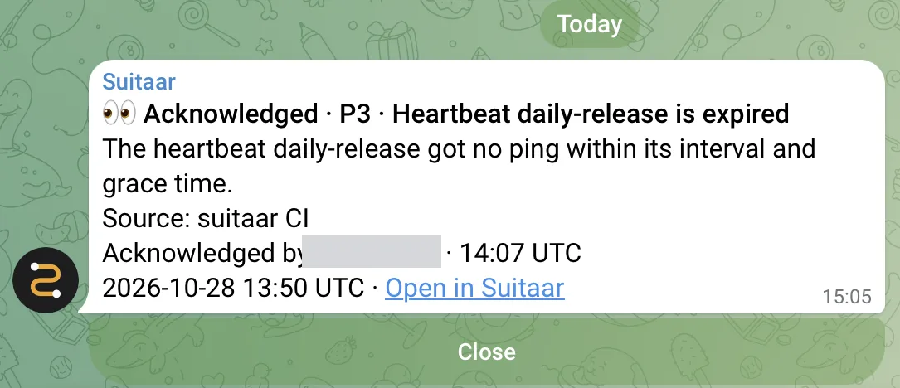

Suitaar now sends alerts to Telegram, in your own chat or a group, with Ack and Close buttons. It works on the free plan, like Slack and Discord. This release also brings one page for your teams, Telegram in the setup, and a clearer warning when Suitaar shows you a key.

{: width="543" height="234" loading="lazy" decoding="async"}

## Telegram

- **Your own chat:** on Destinations, under **Add a destination**, choose **Telegram**, then **Connect your own chat**. Telegram opens; tap **Start**.
- **A group:** choose **Telegram**, then **Connect a group**, and choose the group in Telegram. The bot @SuitaarBot joins it.

Any member of your team can connect a chat. Each alert is one message with its title, priority, source, count and a link. Repeats and Resolved edit that message, so a noisy alert stays one message.

Under an open alert are two buttons:

- **Ack**: anyone in the chat can press it. The alert's timeline shows their Telegram name.
- **Close**: only a member of your team who linked their Telegram account on the Account page (**Link my Telegram account**, under **Sign-in methods**). If new failures came in, press it a second time to confirm.

To stop, send /stop to the bot, or remove the bot from the group. Each channel to a Telegram chat counts toward your channel limit, as for Slack and Discord. Telegram does not break through Do Not Disturb: for alerts at night, pair Suitaar with an on-call tool.

Setup steps: [guide, Telegram](https://suitaar.com/guide#telegram).

## Telegram in the setup

After you sign in for the first time, step 1 of the setup now offers Slack, Discord and Telegram. Choose Telegram, tap Start in Telegram, and the setup goes on to step 2.

## One page for your teams

The Team page is now the one place for teams: see your teams, switch to another team, make a new team, and manage members and invitations. When you accept an invitation, Suitaar switches you into that team.

## Smaller changes

- When Suitaar shows a new key, a box says: "Copy this key now. Suitaar shows it only once." Click or tap the key to select it.
- The [setup guide](https://suitaar.com/guide) shows pictures for each step to get a Slack or Discord webhook URL.
- You can now also sign in with Slack: the sign-in page has **Sign in with Google**, **Sign in with GitHub** and **Sign in with Slack**. New here? The same buttons make your account and your team.

The free plan stays free after the beta: 3 channels, no payment details.
