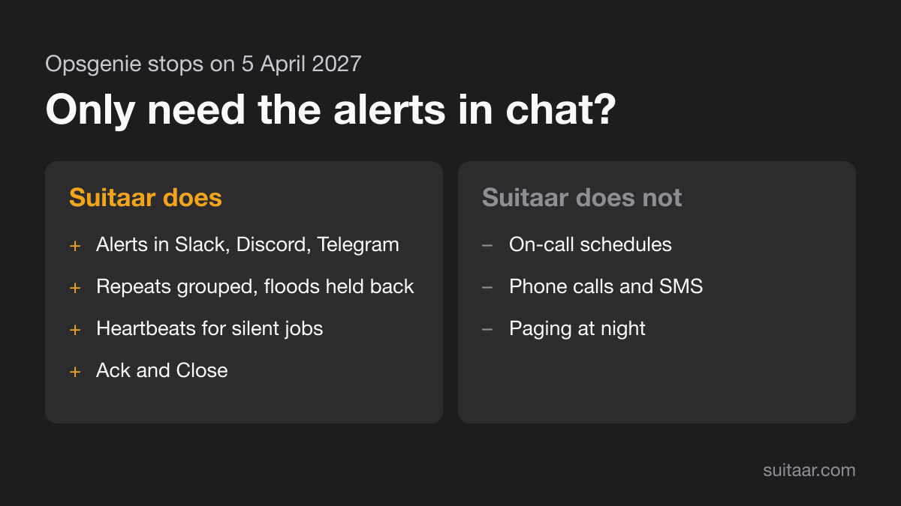
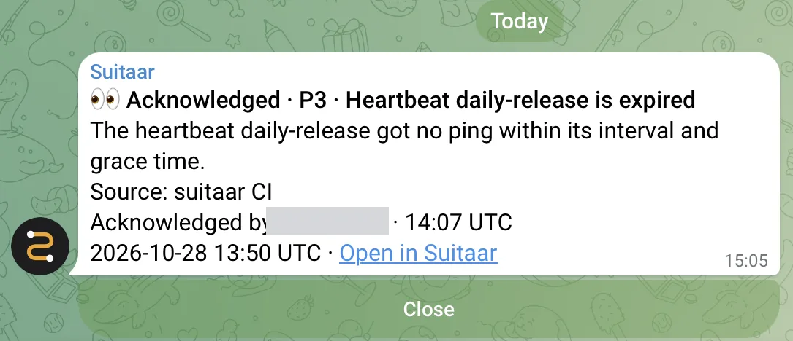

Opsgenie stops on 5 April 2027. Many teams use it for two jobs: paging the person on call, and putting alerts in the team chat. Some teams only need the second job. This post is for them. Suitaar is our product, so we say plainly what it does not do.

{: width="1200" height="675" loading="lazy" decoding="async"}

## What the second job needs

- Alerts from the tools you already run, such as Alertmanager and Grafana.
- A readable channel: repeats grouped, and a flood held back.
- A way to know when a job stops running.
- A way to say "I have this": acknowledge and close.

If you also need someone woken at night, that is the first job. See the last section.

## What Suitaar does

- **Speaks the Opsgenie Alert API.** A tool that lets you set the Opsgenie URL, for example Alertmanager or Grafana, needs a new URL and a new key. Nothing else changes in the tool.
- **Sends to Slack, Discord and Telegram.** For Telegram, alerts go to your own chat or to a group.
- **Groups repeats.** A repeating alert is one alert with a count, not a new message each time.
- **Holds back a flood.** A flood of alerts becomes one summary instead of hundreds of messages. In our load test, 1,000 alerts in one minute, none were lost.
- **Watches for silence.** A heartbeat opens an alert when the pings from a cron job or a monitor stop.
- **Acknowledge and close.** In Telegram, buttons sit under the message. For Slack and Discord, use the alert page in Suitaar or the API.
- **The free plan stays free after the beta:** 3 channels, no payment details.

{: width="543" height="234" loading="lazy" decoding="async"}

## What Suitaar does not do

- It has no on-call schedules and no rotations.
- It makes no phone calls and sends no SMS. It does not page anyone at night.
- Telegram does not break through Do Not Disturb. For alerts at night, pair Suitaar with an on-call tool.
- Some tools send only to Opsgenie's own servers, for example the Opsgenie integrations of Uptime Kuma, Healthchecks.io and Sentry. They need another way in, usually the tool's own webhook. See [Uptime Kuma, Healthchecks.io and UptimeRobot](/posts/uptime-kuma-healthchecks-uptimerobot/) and [Sentry in the same channel](/posts/sentry-same-channel/).
- Today it sends to Slack, Discord and Telegram.

## How to check it

1. Open the [demo](https://suitaar.com/demo). It needs no account.
2. Sign in with Google, GitHub or Slack, and follow the three setup steps: a destination, a source, a new URL in your tool.
3. Send to Opsgenie and Suitaar side by side for a week, and compare. For Alertmanager, see [Moving Alertmanager off Opsgenie](/posts/moving-alertmanager-off-opsgenie/). For the full list of checks, see [Before you move off Opsgenie](/posts/before-you-move-off-opsgenie/).

[Setup guide](https://suitaar.com/guide) · [Try it without an account](https://suitaar.com/demo)

## Related posts

- [Grafana's Opsgenie contact point after Opsgenie shuts down](/posts/grafana-opsgenie-contact-point/)
- [Opsgenie heartbeats: what replaces them](/posts/opsgenie-heartbeats-replacement/)
- [The Opsgenie Python SDK, Go SDK and Terraform provider after the shutdown](/posts/opsgenie-sdks-terraform/)
