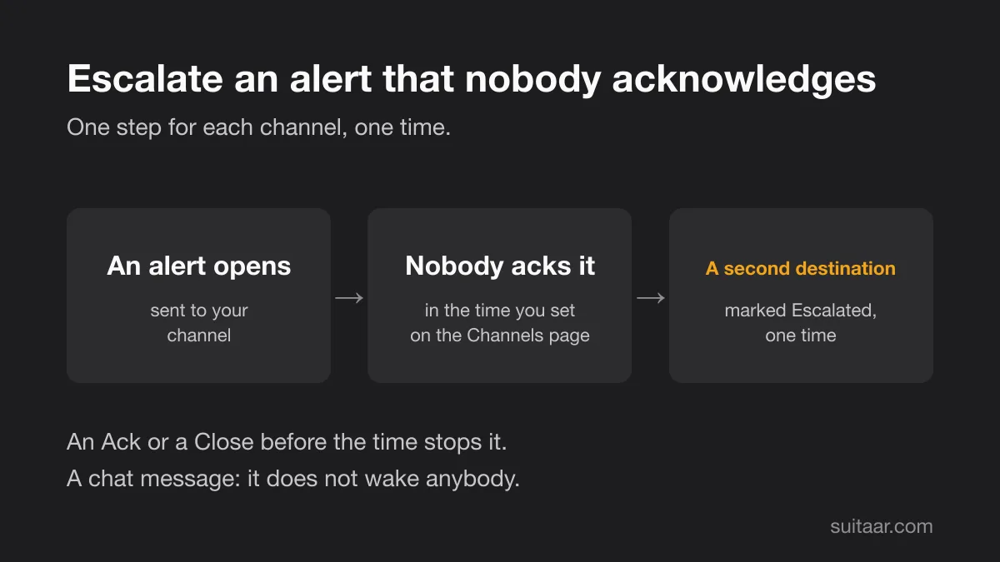

A channel can now send an alert to a second destination when nobody acknowledges it. This release also brings an Ongoing tab on the Alerts page, renaming for sources, destinations, teams and your own name, and a menu at the top right.

{: width="1200" height="675" loading="lazy" decoding="async"}

## Escalation

On the **Channels** page, each channel has an **Escalation** column. Choose a time (5, 10, 15 or 30 minutes, or 1 hour) and a destination, then click **Save**. You need two destinations for this, and the escalation destination must not be the one that the channel sends to.

If the alert is still open when the time is over, Suitaar sends it to that destination one time, marked **Escalated**. An Ack or a Close before that stops it. To turn it off, choose **off**.

This is one step for each channel, and it is a chat message: it does not wake anybody. Suitaar is still not an on-call tool. For the night, pair it with an on-call tool.

Setup steps: [guide, escalation](https://suitaar.com/guide#escalation).

## An Ongoing tab

The Alerts page now opens on **Ongoing**: the open and the acknowledged alerts together. The tabs are Ongoing, Open, Ack, Closed and All, each with a count. The Overview shows the same number as **Ongoing alerts**, with how many are open and how many are acknowledged. Before, the Overview counted both under "Open alerts", but its link opened only the open ones.

## Renaming

You can rename a source, a destination, a team, and your own name. Open the **Advanced** box at the bottom of the page, and choose **Rename**. A new name shows in the dashboard and in new chat messages. Messages that are already in your chat keep the old name. Your own name shows to your team and in the chat messages that say who acknowledged an alert.

## A menu at the top right

The bar at the top now shows Overview, Alerts, Sources, Destinations and Channels (and Activity for admins). Plan, Team, Account and Sign out are in a menu at the top right, under your name. The Overview names your team, with a link to switch or manage teams.

## Smaller changes

- The settings of a destination, a source, a team and your account (rename, replace a URL or a key, delete) are now rows in an **Advanced** box at the bottom of the page.
- If a Save is refused, the message names the channel it is about.
